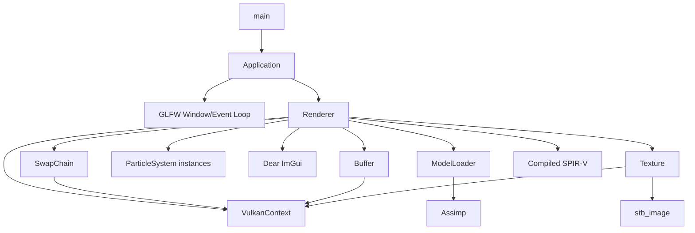

# VulkCore 整体代码框架与现有架构

## 1. 定位与结论

VulkCore 当前是一个以 Vulkan 为后端、用 Dear ImGui 提供运行时调试界面的单进程 3D 渲染原型。它已经形成从窗口、Vulkan 设备、交换链、资源上传、模型导入到材质/粒子绘制的完整闭环，适合验证渲染功能和图形 API 概念。

从架构成熟度看，它还不是传统意义上的“通用游戏引擎”：构建产物只有一个可执行程序；场景、编辑器、资源管理和渲染调度耦合在 `Renderer`；没有独立运行时、ECS、资产数据库、任务系统、模块/插件系统和稳定序列化协议。当前最准确的定位是“功能持续增长中的 Vulkan 编辑器式渲染器”。

## 2. 代码目录与职责

```text
VulkCore/
├── CMakeLists.txt                 构建依赖、Shader 编译、可执行目标
├── include/vulkcore/
│   ├── Application.hpp            应用生命周期接口
│   ├── Core/Config.hpp            编译期路径、窗口和帧数量常量
│   ├── Renderer/
│   │   ├── VulkanContext.hpp      实例、设备、队列、命令池
│   │   ├── SwapChain.hpp          交换链、视图、深度与帧缓冲
│   │   ├── Buffer.hpp             VkBuffer + 独占内存封装
│   │   ├── Texture.hpp            2D RGBA 纹理上传与采样器
│   │   ├── Vertex.hpp             静态网格顶点布局
│   │   ├── UniformBuffer.hpp      帧级相机和灯光常量
│   │   ├── Mesh.hpp               场景节点、网格分段、材质数据
│   │   ├── ParticleSystem.hpp     粒子参数、状态和 CPU 模拟
│   │   └── Renderer.hpp           全部渲染/编辑器调度与 GPU 资源所有权
│   └── Utils/
│       ├── FileUtils.hpp          二进制文件读取
│       └── ModelLoader.hpp        Assimp 模型导入入口
├── src/                            与头文件对应的实现
├── shaders/src/                    GLSL 源文件
├── assets/models/                  默认场景及模型纹理约定目录
├── assets/textures/                外部纹理资源
└── vulkcore.ini                    当前场景编辑状态的文本持久化
```

构建层使用 C++20、Vulkan、GLFW、GLM、Assimp、Dear ImGui 和 stb_image。CMake 在构建时用 `glslc` 把 `*.vert/*.frag/*.geom/*.tesc/*.tese/*.comp` 编译到构建目录，再把 Shader、模型和配置路径作为编译宏写入可执行程序。

## 3. 当前运行时依赖关系



依赖方向整体从应用层流向 Vulkan 基础设施，但 `Renderer` 同时扮演以下角色：

- 渲染器门面与每帧调度器；
- 场景容器和场景节点编辑器；
- 材质、Shader、纹理及描述符管理器；
- Vulkan Render Pass/Pipeline 工厂和缓存；
- 粒子系统宿主、模拟调度和批次生成器；
- ImGui 面板控制器；
- 配置文件序列化器；
- GPU 同步及交换链重建协调器。

这使功能闭环很直接，但所有权和修改原因过多。`Renderer.cpp` 已超过四千行，任何新渲染特性都可能同时影响 UI、配置、资源创建、描述符、命令录制和析构路径。

## 4. 程序生命周期

### 4.1 启动

`main()` 创建 `Application` 并调用 `run()`。`Application` 初始化 GLFW，创建一个 `GLFW_NO_API` 的 1920×1080 窗口，再构造 `Renderer`。

`Renderer` 构造阶段按依赖顺序完成：

1. 创建 `VulkanContext`：Instance、Debug Messenger、Surface、Physical Device、Logical Device、Graphics/Present Queue、Command Pool。
2. 创建 `SwapChain`：交换链图像、图像视图及共享深度图像。
3. 创建最终合成 Render Pass、逐帧离屏场景 Render Target、统一 Descriptor Set Layout 和 Pipeline Layout。
4. 创建默认网格、包围盒和粒子 Graphics Pipeline。
5. 为交换链图像创建 Framebuffer。
6. 通过 Assimp 导入模型，生成太阳节点和材质，读取 `vulkcore.ini` 恢复运行时编辑状态。
7. 创建静态网格 Buffer、逐帧粒子/包围盒/Uniform Buffer、材质及粒子纹理、Descriptor Pool/Sets。
8. 分配逐帧 Command Buffer、Semaphore、Fence，最后初始化 ImGui Vulkan backend。

该顺序体现了明确的 GPU 依赖，但构造函数承担了大量可能抛异常的工作。长期应改成分阶段初始化并返回结构化错误，避免构造/析构路径成为唯一恢复机制。

### 4.2 主循环

`Application::mainLoop()` 每轮执行 `glfwPollEvents()` 和 `Renderer::drawFrame()`。没有固定更新步长、逻辑线程、后台任务或独立的 Editor Tick；粒子模拟和 UI 都依附渲染帧率。

### 4.3 退出

`Application` 先销毁 `Renderer`，再销毁窗口并终止 GLFW。`Renderer` 析构前调用 `vkDeviceWaitIdle`，随后手工按逆依赖顺序销毁所有 Vulkan 对象。`VulkanContext` 自身析构也会等待设备空闲。

这种方式正确性直观，但存在两个问题：正常退出有重复等待；资源所有权大量使用裸 `Vk*` 句柄，需要所有新路径都正确补齐清理。目标架构应使用类型化 RAII 句柄、延迟销毁队列和 Frame Context，将销毁时机从全局停机改为依据 GPU 完成值回收。

## 5. Vulkan 基础层

### 5.1 `VulkanContext`

已承担的能力：

- Debug 构建启用 `VK_LAYER_KHRONOS_validation` 和 Debug Utils；
- 通过 GLFW 创建 Surface；
- 选择同时满足 Graphics、Present、Swapchain 和格式/呈现模式支持的物理设备；
- macOS 可请求 portability enumeration/subset 扩展；
- 创建 Graphics/Present Queue 和可重置 Command Pool；
- 提供内存类型查询、Buffer Copy 和一次性 Command Buffer 辅助方法。

当前设备选择是“第一个满足条件的设备”，没有能力评分、显存预算、可选特性协商或驱动能力数据库。逻辑设备没有启用各向异性、时间线信号量、动态渲染、Descriptor Indexing 等现代特性；API 目标为 Vulkan 1.0。

### 5.2 `SwapChain`

交换链偏好 `B8G8R8A8_SRGB + SRGB_NONLINEAR`；Present Mode 优先 Mailbox，否则 FIFO；图像数为 `minImageCount + 1`，受上限约束。图像用途包含 Color Attachment 和 Transfer Destination，因为当前帧流程会把离屏颜色拷贝到交换链图像。

每个交换链图像有独立 Color View/Framebuffer，但所有 Framebuffer 共用一个深度图像。这在当前串行使用模式下可以工作，却限制真正的多帧并行，也使交换链对象混入了“最终渲染深度资源”的职责。更稳健的做法是深度资源跟随每个交换链图像或每个 Frame Context，或由 Render Graph 按生命周期分配。

## 6. 场景、网格与材质数据模型

### 6.1 模型导入与扁平网格

`ModelLoader` 使用 Assimp 的三角化、相同顶点合并、平滑法线生成、缓存局部性优化和 UV 翻转。导入过程把各节点的累计 Assimp 变换直接烘焙到顶点位置/法线，并把所有几何合并到一组 32 位 Vertex/Index Buffer。

`MeshPart` 只记录 `firstIndex/indexCount/materialIndex/nodeId`，用于按材质和节点分段绘制。此方式减少了 Buffer 和 Draw Call 管理复杂度，适合单场景展示；代价是：

- 原始 Mesh 资产与场景实例没有分离，同一 Mesh 无法低成本实例化；
- 顶点已经带全局导入变换，节点运行时 Transform 是后乘的编辑偏移，不是纯粹的原始局部层级；
- 不能独立卸载或流式加载子网格；
- 静态/蒙皮/变形网格没有统一资产接口；
- 资产重导入时节点 ID、材质覆盖和配置迁移缺少稳定标识保障。

### 6.2 节点层次

`ModelNode` 保留名称、运行时递增 `nodeId`、原始全局变换、直接 MeshPart、子节点、聚合 Bounds、可编辑平移/旋转/统一缩放、旋转动画和材质覆盖。`MeshData::additionalNodes` 存放导入根节点之外的生成对象，如太阳与粒子对象。

粒子对象通过 `SceneObjectType::ParticleSystem` 区分，并在 `Renderer::particleSystems_` 中用同一 `nodeId` 找到组件状态。它满足“粒子系统必须绑定 GameObject/场景对象”的用户语义，但数据结构仍是类型枚举加旁路 Map，不是可组合组件模型。例如一个节点不能自然地同时拥有 MeshRenderer、ParticleEmitter、Light 和 Script。

### 6.3 材质

`MaterialData` 同时保存：

- Base Color、Metallic、Roughness、Opacity、Emission；
- Opaque/Alpha/Additive/Multiply、Depth Write、Double Sided；
- Base/Normal/Specular 外部或嵌入纹理；
- 六种 Shader Stage 的文件名覆盖；
- 水面 Flow 参数；
- 用户创建/修改状态。

节点材质覆盖可以向子树继承。相同材质状态和 Shader 配置通过字符串 Key 共享 Pipeline。当前材质是 CPU 可编辑结构体，而不是“Material Asset + Material Instance + 参数块”的分层模型，因此材质定义、实例参数、编辑状态和 GPU 绑定策略互相耦合。

## 7. 粒子系统架构

每个粒子系统绑定一个 `ModelNode`，`Renderer` 以节点 ID 管理独立 `ParticleSystem`、纹理和每帧 Descriptor Set。参数覆盖启用、自动播放、循环、最大数量、发射率、持续时间、生命周期、速度与随机度、重力、Point/Sphere/Cone、方向/锥角、半径、尺寸/颜色渐变、旋转速度及 Alpha/Additive 混合。

模拟在 CPU 完成：发射器累计小数粒子数，生成随机初始状态，逐帧积分速度/重力/位置/旋转并淘汰死亡粒子。构建渲染数据时，根据相机 Right/Up 在 CPU 展开每个粒子的两个三角形，即每粒子 6 个 `ParticleVertex`；Alpha 模式会在单个系统内部按相机距离排序。随后一次上传逐帧动态顶点 Buffer，按系统范围绘制。

当前硬边界包括单系统最多 2048 粒子、最多 16 个系统、CPU 模拟、每帧完整顶点重建和上传、系统间不做全局透明排序。它是合理的第一版，但数量级提升应转向 GPU Simulation + Instance/Indirect Draw，而不是继续扩大 CPU 顶点数组。

## 8. 资源与所有权

### 8.1 Buffer

`Buffer` 一对一拥有 `VkBuffer` 和一次 `vkAllocateMemory` 得到的内存。`upload()` 每次 Map、Memcpy、Unmap；静态网格通过 staging copy 上传，Uniform/粒子/包围盒使用 Host Visible + Coherent 内存。

优点是生命周期清晰。主要扩展瓶颈是没有内存子分配、持久映射、帧环形上传区、对齐策略和显存预算，资源数量增长后会产生分配开销与内存碎片。

### 8.2 Texture

`Texture` 支持文件、Assimp 压缩嵌入数据和原始 RGBA 数据，统一上传为 `R8G8B8A8_SRGB`。每个纹理独立创建 Image、Memory、View 和 Sampler；仅 1 个 Mip，线性过滤、Repeat、无各向异性。

当前缺少纹理缓存和资产去重，同一路径可能对应多个 GPU 资源；Normal/Specular 也使用 sRGB 格式，严格的 PBR 管线中应按数据语义使用 Linear 格式。Sampler 也应与 Image 解耦并缓存。

### 8.3 Descriptor 与 Pipeline

所有材质和粒子共享一个固定的五 Binding Descriptor Layout。每帧、每材质分配一组 Descriptor Set；粒子对象也各自拥有两帧 Descriptor Set。材质变化会重建相关纹理/Descriptor 资源，扩展到大量材质时成本高。

Pipeline 根据 Shader 名和有限渲染状态生成字符串 Key 缓存。机制已经具备“按材质变体缓存”的雏形，但缺少 Shader Reflection、Pipeline Cache 持久化、异步编译、格式化 Key、兼容性验证和错误材质可视化。

## 9. 编辑器与持久化

Dear ImGui 直接在 `Renderer::buildImGuiFrame()` 中构建控制面板。节点选择通过 `ModelNode*` 保存；面板直接修改运行时数据结构，必要时触发纹理/Descriptor/Pipeline 重建并写入 `vulkcore.ini`。

配置文件是按行 token 化的自定义文本格式，包含节点 Transform、材质、纹理、Shader、水面参数和粒子对象。已有部分向后兼容读取逻辑，但没有：

- 格式版本和显式 Schema；
- UUID/GUID 资产引用；
- 事务写入、备份和损坏恢复；
- Undo/Redo 命令；
- 场景与用户编辑器偏好的分离；
- Prefab、继承、Override Diff；
- 运行态与编辑态隔离。

建议不要继续无限扩展该行协议。短期至少加 `format_version` 和原子替换；中期迁移到版本化 Scene/Asset Schema，并保留一次性旧格式导入器。

## 10. 当前架构的正向基础

- Vulkan 对象创建链路完整，资源销毁大体遵循依赖逆序；
- 数据结构和 GPU 接口规模小，适合作为重构时的行为基线；
- 网格、材质分段、节点层次、粒子对象已经形成最小场景语义；
- Shader 源码、SPIR-V 输出和运行时发现分离；
- 两帧并行资源、Fence/Semaphore 和交换链重建路径已经存在；
- 材质 Pipeline 缓存、纹理 fallback、配置迁移体现了可扩展方向；
- 粒子不作为全局特效存在，而是绑定场景对象，符合后续组件化迁移方向。

## 11. 主要结构性问题

| 问题 | 直接影响 | 演进建议 |
|---|---|---|
| `Renderer` 职责过载 | 改动面大、难测试、容易破坏资源生命周期 | 先拆 Frame/Resource/Scene/Editor，再引入 Render Graph |
| 可执行目标即引擎 | 无法复用、无 Editor/Runtime 分离 | 拆分 `VulkCoreRuntime`、`VulkCoreEditor`、Sample/Test targets |
| 场景节点与组件旁路 Map | 组合能力弱、功能类型膨胀 | 稳定 Entity ID + Component Registry/System |
| 资产数据与实例混合 | 无法实例化、重导入、流式加载 | Asset/Instance 分层，Handle 引用和 Asset Database |
| 裸 Vulkan 句柄集中管理 | 错误路径复杂、销毁同步粗粒度 | RHI RAII、Frame Context、Deferred Deletion Queue |
| 固定 Descriptor Layout | Shader 扩展必须改核心代码 | Reflection 生成布局 + 频率分组参数块 |
| UI 直接改渲染数据 | 无 Undo/Redo、线程和验证边界 | Editor Command/Property System + Runtime World 镜像 |
| 自定义无版本配置 | 兼容和恢复风险持续上升 | 版本化 Schema、GUID、迁移器、原子保存 |

## 12. 建议的源码阅读路径

要理解程序行为，建议按以下顺序阅读：

1. `Application.cpp`：确认主循环与生命周期边界。
2. `VulkanContext.cpp`、`SwapChain.cpp`：理解设备和呈现资源。
3. `Mesh.hpp`、`ModelLoader.cpp`：理解 CPU 场景数据如何形成。
4. `Renderer` 构造、`drawFrame()`、`recordCommandBuffer()`：建立每帧主线。
5. Descriptor、Pipeline 和纹理创建函数：理解材质到 GPU 的映射。
6. `ParticleSystem.cpp` 与粒子 Shader：理解对象绑定、模拟和 Billboard 数据。
7. 配置读取/保存及 ImGui 面板：理解编辑如何反向影响运行时资源。

图形命令和同步细节见[图形管线文档](02-rendering-pipeline.md)，结构重构方案见[目标架构文档](04-scalable-engine-architecture.md)。
