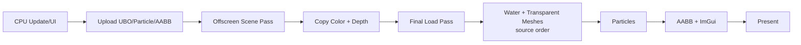
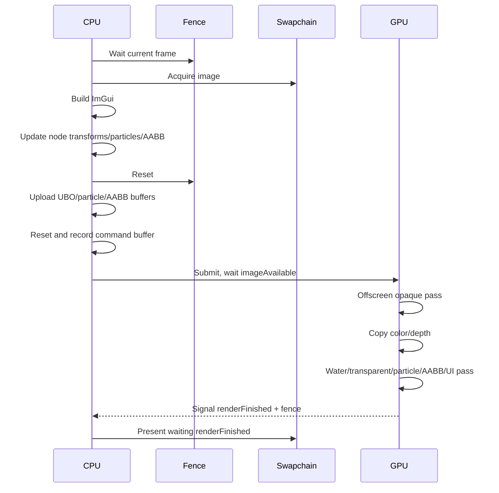

# VulkCore Vulkan 图形管线与帧流程

## 1. 总览

默认前向渲染路径先将不透明网格绘制到逐帧离屏颜色和深度目标，然后把结果复制到交换链颜色和对应深度图。最终 Render Pass 加载这对附件，按 MeshPart 顺序绘制水面和透明材质，再绘制粒子、选中包围盒和 ImGui。



这条管线能让水面采样“水面之前的不透明场景颜色”，但并没有采样离屏深度。当前 Descriptor Layout 的 binding 2 仅绑定场景颜色，水 Shader 也是纯屏幕空间颜色扰动与镜像采样；因此它不具备基于场景深度的岸线泡沫、水深吸收、真实厚度或遮挡判断。

## 场景可选的 HDR 合成

旧前向路径在旧版后处理完成后才提交透明网格和粒子，离屏颜色格式还跟随交换链。材质已经支持加法混合和自定义着色器，但发光线条无法进入那条路径的 Bloom，超出显示范围的光强也会提前截断。

场景声明 `hdr_composition` 后，渲染器按帧分配 FP16 颜色和深度目标。不透明网格、透明网格和粒子共享目标及深度测试。颜色先进行亮度提取、多级下采样和升采样，再以加法合成 Bloom。SMAA Medium 从原场景颜色计算边缘及权重，在最终合成中执行邻域混合。输出到 sRGB 交换链时由硬件编码，UNORM 交换链由全屏着色器编码。ImGui 最后绘制。

HDR 路径直接合成到交换链，省掉旧路径的整屏颜色和深度拷贝。有材质采样不透明场景时，HDR 路径会额外生成一份兼容现有水面着色器的 LDR 颜色和深度快照。场景参数只决定是否分配相应的后处理资源以及各级参数。HDR 回退到旧路径时，材质动画仍可播放，效果受旧目标格式和绘制顺序约束。

### 可复用的场景记录

| 记录 | 参数顺序 |
|---|---|
| `hdr_composition` | Bloom 级数、阈值、阈值平滑宽度、强度、升采样半径、材质曝光、SMAA 开关、线性背景 RGB。级数为 0 时跳过 Bloom。 |
| `authored_view` | 相机目标 XYZ、向上向量 XYZ、垂直 FOV、最小构图宽高比。启用时按模型的原始场景单位绘制，位置由 `camera_position` 指定。 |
| `material_transition` | 正向延迟、时长、循环停留时长、启动时循环开关、激活 FOV、激活机位距离偏移。时间单位为秒，FOV 为 0 时跳过相机过渡。 |
| `material_effect` | 材质索引、透明背面优先双绘制、深度比较 LessEqual、采样不透明快照、绑定进度、可见起止进度、自定义向量开关、两个 `vec4`。 |

材质绑定使用已有的 128 字节 Push Constants ABI。绑定进度时，`opacity` 是材质不透明度乘场景进度。自定义向量占用末尾两个 `vec4`，供自定义 shader 解释。帧 UBO 的 `time.y` 提供独立流动时钟，`time.z` 提供曝光。透明队列按场景顺序绘制，透明双面材质可配置先绘背面再绘正面。场景资产、shader 选择和通道参数由场景声明。`material` 的基础色纹理字段可以使用 `"@embedded"`，在覆盖材质参数时继续使用模型内嵌贴图。

### 实体到线条车示例

`scenes/solid_to_wireframe.scene` 使用 SU7 体验页发布的实体车 GLB 和参考示例的线条网格。GLSL 沿实体长轴裁切，发光带宽为 0.06 个场景单位。原始线条材质整体随进度显现，保留原 UV、顶点色和流动噪声。正向延迟 0.2 秒，正反向各 1 秒，使用 cubic ease-in-out。中途反向时以当前进度为起点。

```bash
./build/vulkcore --scene scenes/solid_to_wireframe.scene
./build/vulkcore --scene scenes/solid_to_wireframe.scene --capture-frame 1 2.4 640 400 /tmp/linecar.png
```

按住空格显现线条，松开恢复实体。编辑器面板支持拖动进度、正放、反放、循环和暂停线条流动。固定帧截图使用初始机位，分别传入进度和流动时间。

与 Three.js 参考示例同机位、同进度和同流动时间对照时，过渡和后处理顺序一致，网格线栅格化、噪声数值以及细线覆盖存在像素差异。

## 2. Vulkan 初始化链路

### 2.1 Instance 与调试层

- Vulkan API 版本声明为 1.0。
- Debug 构建要求 `VK_LAYER_KHRONOS_validation`。
- Debug Messenger 接收 verbose、warning、error，以及 general、validation、performance 类型。
- Surface 扩展来自 GLFW；在需要的实现上启用 portability enumeration。

当前没有 Validation Feature 配置、GPU Assisted Validation、Best Practices Validation 或 Debug Object Name。排查复杂资源问题时，裸句柄很难映射回引擎对象，建议尽早为所有 Buffer/Image/Pipeline/Pass 写入 `VK_EXT_debug_utils` 名称。

### 2.2 物理设备与逻辑设备

设备最低条件是：Graphics/Present Queue Family 完整、支持 Swapchain Extension、交换链格式和 Present Mode 非空。选择第一个合格设备，没有离散 GPU 优先、显存容量、队列能力和扩展评分。

逻辑设备只创建 Graphics/Present 所需队列，没有显式启用 `VkPhysicalDeviceFeatures`。因此当前纹理采样器关闭 Anisotropy；也没有单独 Transfer/Compute Queue、Timeline Semaphore、Descriptor Indexing 或 Dynamic Rendering。

### 2.3 Command Pool

Command Pool 绑定 Graphics Queue Family，支持重置 Command Buffer。正式帧每个 Frame in Flight 一条主 Command Buffer；资源上传通过一次性 Command Buffer 提交后同步等待完成。

一次性提交易于保证正确性，但每张纹理会经历 staging、两次 layout transition 和 copy 的多个短 Command Buffer/Queue Wait。批量资产导入时应使用 Upload Context 聚合命令和 Timeline 完成值。

## 3. 交换链与帧资源

### 3.1 交换链策略

| 项目 | 当前策略 |
|---|---|
| Surface Format | 优先 `VK_FORMAT_B8G8R8A8_SRGB` + `SRGB_NONLINEAR` |
| Present Mode | 优先 Mailbox，否则 FIFO |
| Image Count | `minImageCount + 1`，不超过最大值 |
| Image Usage | Color Attachment + Transfer Destination |
| Sharing | Graphics/Present 家族不同则 Concurrent，否则 Exclusive |
| MSAA | 1 sample |

交换链图像作为最终颜色附件及旧路径的拷贝目标。Color View 按交换链图像独立创建。

### 3.2 Frame in Flight

`kMaxFramesInFlight = 2`。每帧拥有：

- 一条主 Command Buffer；
- Image Available Semaphore；
- In-flight Fence；
- 一份 Uniform Buffer；
- 一份动态粒子 Vertex Buffer；
- 一份动态包围盒 Vertex Buffer；
- 一组离屏 Scene Color/Depth/Framebuffer；
- 每材质及每粒子对象对应的 Descriptor Set。

交换链的最终深度图和 Render Finished Semaphore 按交换链图像分别分配。重新取得该图像后，对应的呈现信号量可复用。

## 4. CPU 到 GPU 的数据接口

### 4.1 静态网格顶点

`Vertex` 的 binding 0 为逐顶点输入：

| Location | 类型 | 语义 |
|---:|---|---|
| 0 | `vec3` | Position |
| 1 | `vec3` | Normal |
| 2 | `vec2` | UV0 |
| 3 | `vec4` | Vertex Color |

所有导入网格合并为一套 Vertex/Index Buffer，索引为 32 位。每个 `MeshPart` 使用 `vkCmdDrawIndexed(firstIndex, indexCount)` 绘制。

### 4.2 帧级 Uniform Buffer

Descriptor set 0, binding 0 为 `UniformBufferObject`：

| 字段 | 含义 |
|---|---|
| `model` | 全局模型归一化变换 |
| `view` | 相机 View Matrix |
| `projection` | Vulkan Y 轴修正后的 Projection Matrix |
| `time.x` | 启动后的秒数 |
| `viewport` | 宽、高及其倒数 |
| `ambientLight` | RGB + 强度 |
| `sunLightDirection` | XYZ + 强度 |
| `sunLightColor` | RGB + 保留值 |

该 UBO 每帧 Map/Copy/Unmap。相机目前硬编码为从 `(3.5, 3.5, 2.8)` 看向原点，Shader 中镜面反射的 View Direction 也是近似常量，并非由每像素 World Position 和真实 Camera Position 计算。这会让移动相机后的高光和 Fresnel 不正确，也是引入 Camera Component 前应修复的接口问题。

### 4.3 材质 Push Constants

统一 `MaterialPushConstants` 包含节点变换、Base Color、纹理标志、Metallic、Roughness、Opacity，以及复用的 Water/Emission 参数。它同时供基础材质、水材质、粒子和包围盒 Pipeline 使用兼容的 Pipeline Layout。

Push Constants 适合高频小数据，但当前结构承载多个不相关材质模型，字段语义会随 Shader 改变。长期应按 Pass/Material Schema 生成独立参数布局，并在 Shader Reflection 后验证大小、Offset 和 Stage Mask。

## 5. Descriptor 模型

所有图形和占位 Compute Pipeline 共享一个 set 0：

| Binding | 类型 | 当前语义 |
|---:|---|---|
| 0 | Uniform Buffer | 帧级相机、时间、灯光 |
| 1 | Combined Image Sampler | Base Color 或 Particle Texture |
| 2 | Combined Image Sampler | 当前帧离屏 Scene Color，供水面采样 |
| 3 | Combined Image Sampler | Normal Texture |
| 4 | Combined Image Sampler | Specular Texture |

每帧每材质复制一套 Set；粒子对象每帧一套 Set。即使某个 Shader 不使用某 Binding，也通过 fallback 资源保持 Descriptor 完整。

这是一种简单的“超集布局”，好处是 Pipeline Layout 统一、绑定代码少；不足是：

- 新增 Shadow Map、Environment Map、Skinning Buffer 等资源必须修改全局布局；
- Frame、View、Material、Object 不同更新频率没有分 Set；
- Descriptor 数量随 `frames × materials` 线性增长；
- Shader 文件可自由选择，但接口只能靠约定，没有 Reflection 验证；
- Compute 也被迫使用图形材质布局，无法表达 Storage Buffer/Image；
- 无 Bindless/Descriptor Indexing，批次切换成本较高。

建议的频率分层是：set 0 Frame/View，set 1 Scene/Lighting，set 2 Material，set 3 Object/Draw；对支持 Descriptor Indexing 的设备再把纹理放入全局数组，以稳定 Material Handle。

## 6. Graphics Pipeline

### 6.1 基础网格 Pipeline

基础管线使用 `shader_base.vert` 和 `shader_base.frag`，输入为三角形列表，启用动态 Viewport/Scissor、Back-face Culling、深度测试和深度写入。材质可以改变混合、Depth Write 和 Double Sided，并由 Pipeline Cache 选择变体。

基础 Fragment Shader 实现的是简化经验光照：

- Base Texture × Base Color × Vertex Color；
- 用导数构建 TBN 的 Normal Mapping；
- 环境光 + 单方向太阳漫反射；
- 由 Roughness 控制指数、Metallic 控制幅度的 Blinn-Phong 风格高光；
- Specular Texture 单通道调制；
- Emission 叠加。

虽然数据字段名包含 Metallic/Roughness，但这不是基于 Cook-Torrance、能量守恒、IBL 的标准 PBR。资产从 DCC/PBR 工作流导入时视觉语义并不完全匹配。

### 6.2 材质 Shader 变体

运行时扫描构建目录中的 SPIR-V 文件，按扩展识别 Vertex、Tessellation Control/Evaluation、Geometry、Fragment、Compute。材质未配置的 Vertex/Fragment 回退默认 Shader；Tessellation Control/Evaluation 必须成对出现。

Graphics Pipeline Key 由 Shader 名和材质渲染状态拼接而成。成功创建后缓存，失败 Key 也缓存并回退默认管线，避免每帧重复失败。Compute Shader 可以创建并验证 Compute Pipeline，但当前帧没有 `vkCmdDispatch`，也没有 Storage Resource 绑定，所以属于“管线创建已实现，计算任务语义未实现”。

当前缺少：

- SPIR-V Reflection 和跨 Stage Interface 校验；
- Shader Include/Permutation/Define 管理；
- 文件变化检测与热重载；
- Pipeline Cache 文件持久化；
- 后台编译和占位 Pipeline；
- 材质模板、参数元数据和 Inspector 自动生成；
- Pipeline 创建失败的 UI 诊断详情。

### 6.3 水面 Pipeline

水面 Vertex Shader 沿法线进行程序化波浪位移；两个 Fragment 预设分别提供常规水面与流动水面。它们使用时间、Flow 参数、法线扰动、单方向光和 Fresnel 近似，并用 `gl_FragCoord / viewport` 构造屏幕 UV，从离屏 Scene Color 读取折射和上下翻转的伪反射。

需要明确其效果边界：

- “反射”是当前屏幕颜色的垂直镜像，不是 Planar Reflection，也不是 SSR；
- 不采样 Scene Depth，无法正确处理水体厚度、交界和折射遮挡；
- Flow Shader 在缺少专用 Flow Map Binding 时复用 Base Texture 的 RG，并限制其扰动幅度；
- 水面必须在离屏不透明场景之后绘制；多个透明水面之间没有顺序求解；
- 相机方向常量会影响 Fresnel 与高光准确性。

### 6.4 粒子 Pipeline

粒子有 Alpha 和 Additive 两条 Pipeline。深度测试开启、深度写入关闭；顶点已经在 CPU 端展开为 Camera-facing Quad。Vertex Shader 直接使用 View/Projection，因为粒子位置已处在归一化场景空间；Fragment Shader 采样用户纹理并乘生命周期颜色，未配置纹理时产生程序化软圆形 Alpha。

粒子纹理加载使用 stb_image 支持的 RGBA 解码路径，失败时保留 fallback。纹理颜色与粒子颜色相乘，因此图片应使用透明背景，并注意当前统一 sRGB 格式对颜色数据的影响。

Alpha 粒子只在各自系统内部排序；多个系统之间按容器生成顺序提交，因此交叠时仍可能出现错误混合。Additive 通常不要求排序。

### 6.5 包围盒与 UI

选中节点及其子树的 AABB 在 CPU 计算 24 个线段顶点，上传逐帧 Buffer 后以 Line List 绘制。ImGui 作为最终 Render Pass 的最后一个绘制项写入交换链颜色。

## 7. 每帧执行时序

`Renderer::drawFrame()` 的真实时序如下：



粒子 `deltaTime` 被限制在 `[0, 0.1]`，可避免窗口阻塞后单帧积分爆炸，但模拟仍为可变步长，不能保证重放确定性。游戏逻辑成熟后应使用固定 Tick，并在 Render World 中插值。

## 8. Command Buffer 录制详解

### 8.1 Pass A：离屏不透明场景

以当前 Frame Context 的 `SceneRenderTarget` 开始 `sceneRenderPass_`：

- Color 清为深蓝灰色；
- Depth 清为 1.0；
- 绑定合并后的 Vertex/Index Buffer；
- 遍历 `MeshPart`；
- 跳过水面 Shader；
- 跳过所有非 Opaque Blend Mode；
- 计算节点继承材质和节点 Transform；
- 绑定材质 Pipeline、当前帧材质 Descriptor Set 和 Push Constants；
- 发出 `vkCmdDrawIndexed`。

该 Pass 输出每帧独立 Scene Color 和 Scene Depth。Scene Color 最终布局为 Shader Read，但在拷贝前会显式转为 Transfer Source；Depth 同样转为 Transfer Source。

### 8.2 中间图像拷贝

命令依次处理布局/访问同步，然后：

1. `vkCmdCopyImage`：Scene Color → Swapchain Color；
2. `vkCmdCopyImage`：Scene Depth → Swapchain Shared Depth；
3. Scene Color 转回 Shader Read，供水面采样；
4. Swapchain Color 转为 Color Attachment；
5. Swapchain Depth 转为 Depth Attachment。

该设计避免了单一 Render Pass 内读写同一颜色附件的反馈问题，但每帧产生两次全分辨率图像拷贝，并要求交换链支持 Transfer Destination。更成熟的替代方案包括：

- 将离屏颜色作为全屏合成输入，最终直接写交换链，深度按需求重建或共享；
- 使用 Dynamic Rendering + Render Graph 管理附件状态；
- 水面在独立透明 Pass 读取 Scene Color/Depth，输出到新的合成目标；
- 最终 Tone Mapping/UI Pass 写交换链。

### 8.3 Pass B：最终加载与叠加

最终 `renderPass_` 对 Color/Depth 使用 `LOAD`，保留拷贝结果。绘制顺序为：

1. 水面及其他非 Opaque 材质，保持原始 `MeshPart` 顺序；
2. 各粒子系统；
3. 选中对象 AABB；
4. ImGui。

透明网格按 `MeshPart` 原始顺序绘制，没有按相机深度排序；Multiply/Additive 和 Alpha 也没有建立独立 Render Queue。正确方向是由 Render World 生成 Draw Packet，先按 Pass/Material/Pipeline 分桶，再对 Alpha Queue 使用可配置的 Back-to-front Sort Key。

## 9. 同步与交换链重建

### 9.1 帧同步

CPU 复用当前 Frame Context 前等待 Fence；提交等待 Image Available Binary Semaphore，并在 Color Attachment Output 阶段开始等待；完成后发出 Render Finished Binary Semaphore，Present 等待它。

没有显式的 `imagesInFlight[swapchainImage]` Fence 跟踪。由于最终深度还共享，当前实现依赖队列顺序和帧 Fence 约束。建议按交换链图像记录最近 Fence，或改为每帧独立最终附件并用 Timeline Semaphore 表示队列进度。

### 9.2 Resize/Out-of-date

Acquire 或 Present 返回 Out of Date/Suboptimal，或 GLFW 设置 resize 标志时重建交换链。最小化窗口会等待 framebuffer 恢复非零尺寸。重建前执行 `vkDeviceWaitIdle`，销毁离屏资源，重建 Swapchain/Depth/Framebuffer 和逐帧 Scene Target，再更新 Scene Color Descriptor 与 ImGui image count。

全设备等待实现简单但产生明显停顿。应在资源句柄化后，把旧交换链资源放入延迟销毁队列，并只等待受影响的帧完成。

## 10. 主要正确性与性能风险

| 级别 | 风险 | 原因与后果 | 建议 |
|---|---|---|---|
| P0 | 自定义 Shader 接口无验证 | Stage、Descriptor 或 Push Constant 不匹配可能在运行时创建失败或产生未定义行为 | SPIR-V Reflection + 离线校验 + 错误材质 |
| P0 | 透明物体无全局排序 | Alpha 水面、透明网格和多个粒子系统交叠错误 | Render Queue + 全局 Sort Key，区分 OIT 候选 |
| P1 | 全屏颜色和深度逐帧拷贝 | 带宽消耗随分辨率增长，移动端/集显代价明显 | Render Graph 重构合成路径 |
| P1 | Texture 全部使用 sRGB | Normal/Specular 数据采样空间错误 | 资产语义决定 Linear/sRGB Format |
| P1 | 无 Mipmap/Anisotropy | 远距离闪烁、纹理缓存效率差 | 生成 Mip，设备能力协商后启用 Anisotropy |
| P1 | 共享最终深度 | 限制多帧并行和资源调度 | 每交换链图像/Frame Context 独立深度 |
| P1 | 每资源独立显存分配 | 数量增长后碎片与驱动开销高 | VMA 或自研分配器 + Pool/Suballocation |
| P1 | 粒子 CPU 展开 6 顶点 | 粒子数增长时 CPU 和上传带宽线性增加 | Instance/Storage Buffer + GPU 模拟/间接绘制 |
| P2 | 相机与 View Direction 常量 | 编辑器不可导航，光照随视点不正确 | Camera Component + Camera Position UBO |
| P2 | Pipeline 同步创建 | Shader 变体首次使用可能卡帧 | 离线/后台编译和 Pipeline Cache 持久化 |
| P2 | 每帧 Map/Unmap | 动态数据多时 CPU 开销增加 | 持久映射 Frame Upload Ring |

## 11. 推荐的目标帧管线

近期不必直接上复杂 Deferred Renderer。建议先演进为可描述、可观测的 Forward+ 框架：

```text
Upload/Async Transfer
  -> GPU Culling / Particle Simulation (optional compute)
  -> Shadow Pass
  -> Depth Prepass (按场景规模启用)
  -> Opaque Forward+ (HDR Color + Depth + Velocity/ObjectId)
  -> Water/Transparent (读取 Scene Color + Depth)
  -> Post Process (Bloom/TAA/Tone Mapping)
  -> Selection/Debug Overlay
  -> ImGui
  -> Present
```

每个 Pass 只声明输入、输出和 Queue 类型，由 Render Graph 推导 Barrier、资源生命周期与可别名区间。这样新增 Shadow、Picking、Bloom 或 GPU Particle 不再修改一个巨型 `recordCommandBuffer()`，也能用 GPU Marker/Timing 对每个 Pass 独立分析。

具体模块接口和迁移步骤见[高扩展性引擎目标架构](04-scalable-engine-architecture.md)。
