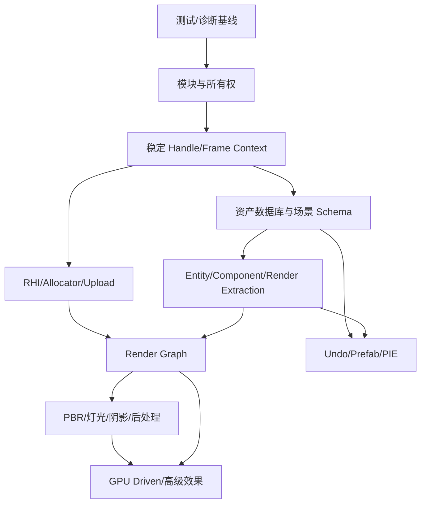

# VulkCore 能力差距、问题分析与演进路线

## 1. 评估口径

“通用完善引擎”不是功能数量的简单相加，而是能够稳定支撑多项目、多平台、多人协作和长期内容生产的一套运行时与工具链。评估至少要覆盖：

- 运行时能力是否完整；
- 模块边界是否允许替换和并行开发；
- 资源、场景与版本是否可以长期兼容；
- 性能是否可测量、可预算、可退化；
- 编辑器是否支持高频内容生产而非只调参数；
- 构建、测试、崩溃诊断和发布是否可重复。

下表中的“缺失”不等于当前项目失败。VulkCore 已经完成一条有价值的 Vulkan 原型链路；问题在于下一阶段若继续把功能直接堆入 `Renderer`，边际成本会迅速上升。因此路线首先处理承载能力，再扩充高级效果。

## 2. 总体成熟度

| 领域 | 当前状态 | 判断 |
|---|---|---|
| 应用/平台层 | GLFW 窗口、事件循环、Resize | 部分实现；没有输入抽象、多窗口、文件/线程/时间平台服务 |
| Vulkan RHI | Instance/Device/Swapchain/Buffer/Texture/同步 | 部分实现；API 直接泄漏、无统一资源句柄和能力协商 |
| 渲染框架 | 前向网格、水面、透明、粒子、AABB、UI | 部分实现；无 Render Graph、Render Queue、可扩展 Pass |
| 场景 | 导入层次、节点 Transform、材质覆盖、粒子对象 | 部分实现；不是 ECS，资产与实例混合 |
| 资产 | Assimp + stb_image，运行时直接加载 | 初级；无资产数据库、导入产物、GUID、依赖图、流式加载 |
| 材质/Shader | 参数、纹理、多阶段选择、Pipeline 缓存 | 部分实现；无 Reflection、模板/实例、Permutation 工具链 |
| 编辑器 | ImGui 层级与参数面板、选择包围盒 | 初级；无 Gizmo、Undo/Redo、Docking 工作流、资产浏览器 |
| 序列化 | `vulkcore.ini` 自定义文本 | 原型；无版本 Schema、稳定引用、原子保存 |
| 粒子 | 绑定对象、基础模块、纹理、CPU Billboard | 基础实现；无模块栈、GPU 模拟、Sub-emitter、碰撞 |
| 动画 | 节点匀速欧拉旋转 | 极小子集；无骨骼、Clip、State Machine、Blend Tree |
| 灯光 | 环境光 + 单方向光 | 基础实现；无 Light Component、Shadow、IBL、探针 |
| 物理/碰撞 | PhysX 5.6.1、地形静态三角网格、Player 动态胶囊、固定步长、重力/跳跃/CCD | 初步实现；无通用刚体组件、碰撞层、触发器和事件 |
| 音频 | 无 | 未实现 |
| 脚本/Gameplay | 无 | 未实现 |
| 导航/AI | 无 | 未实现 |
| 网络 | 无 | 未实现 |
| 测试/分析 | 编译警告、Validation Layer | 初级；无自动测试、帧捕获基线、Profiler、CI |
| 发布/插件 | 单可执行目标 | 未形成引擎 SDK、模块、插件或打包系统 |

## 3. 当前必须优先处理的问题

### 3.1 P0：架构承载能力

#### 单体 `Renderer`

渲染调度、场景状态、UI、序列化、资源和 Vulkan 对象集中，使任何功能都需要跨越多个生命周期阶段。继续增加 Shadow、Picking、Post Process、Animation 或 GPU Particle 会让命令录制和 Descriptor 管理呈组合爆炸。

改进目标不是机械地拆文件，而是建立可验证边界：

- Scene World 只表达实体和组件；
- Extract 阶段生成只读 Render World；
- Render Graph 表达 Pass 和资源依赖；
- RHI 只处理 GPU 对象和命令；
- Editor 通过 Command/Property API 修改 World；
- Asset System 提供稳定 Handle，不让业务层持有 Vulkan 对象。

#### 不稳定的对象与资产身份

节点 ID 来自模型导入过程的递增顺序，外加运行时生成对象。模型层级变更或导入规则改变后，保存在配置中的 Transform、材质和粒子记录可能指向错误对象。

应引入：

- 128-bit Asset GUID：跨机器、重命名稳定；
- Entity UUID：场景保存后稳定；
- Runtime Entity Index + Generation：运行时快速访问并防悬空；
- Import Sub-object ID：由源文件节点路径/稳定元数据生成；
- 明确的 Missing Reference 状态，而不是静默回退。

#### Shader 接口不受控

编辑器允许从目录选择任意阶段 SPIR-V，但 Descriptor、Vertex Input 和 Push Constant 是硬编码约定。错误接口只能在 Pipeline 创建时发现，且 Compute Pipeline 即使创建成功也不执行。

近期应把“选择文件”升级为“选择通过离线校验的 Shader Program”：编译器输出 Reflection Manifest，验证 Stage IO、Descriptor、Push Constant、Render Target Format 和 Feature Requirement。Compute 只有在注册 Compute Pass 并声明资源时才可执行，避免把“可创建 Pipeline”误认为“已支持计算效果”。

### 3.2 P0：数据安全与可恢复性

`vulkcore.ini` 缺少格式版本、原子写入和稳定引用。编辑时直接覆盖工程配置，进程中断可能造成部分写入。最小修复应包括：

1. 文件头 `format_version`；
2. 写临时文件、Flush/Close 成功后原子 Rename；
3. 保存前轮换一份 `.bak`；
4. 读取错误给出行号与对象上下文；
5. 未知字段保留或通过迁移器处理；
6. 将用户界面偏好与 Scene Asset 分离。

中期不要让自定义 token 文件承担所有资产职责。可选择 JSON/YAML 作为可读场景源格式，或 FlatBuffers/Protobuf/自定义 Chunk 作为运行时产物；关键是 Schema、版本和迁移机制，而不是格式名字。

### 3.3 P1：GPU 资源与同步扩展性

当前每个 Buffer/Image 独立分配显存，每次动态上传 Map/Unmap，每个纹理单独同步上传，Descriptor 按帧和材质复制。资源增长后会出现 CPU 开销、碎片、停顿和难以定位的生命周期错误。

需要按顺序建立：

- GPU Allocator：Memory Block + Suballocation，记录 Heap Budget；
- Frame Upload Ring：持久映射，按 Uniform/Storage 对齐；
- Upload Queue：批量 staging，Timeline 完成值；
- Deferred Deletion Queue：资源在最后使用 Fence/Timeline 后回收；
- Resource State Tracker：统一 Image Layout/Access/Queue Ownership；
- Descriptor Allocator/Cache，之后再评估 Bindless。

### 3.4 P1：渲染正确性

当前最明显的问题：透明网格无深度排序、粒子只做系统内排序；Normal/Specular 与颜色纹理统一为 sRGB；高光视线方向常量；水面无深度；共享最终深度资源；材质虽然命名为 Metallic/Roughness，光照却不是标准 PBR。

应先建立渲染回归场景：色彩空间、法线方向、透明叠层、极端 Roughness/Metallic、Resize、纹理缺失、多粒子交叉等。没有这些基线，重构 Render Graph 或 PBR 时很难判断画面变化是改进还是回归。

## 4. 与通用引擎相比尚未实现的功能

### 4.1 Core 与 Platform

- 分层日志、日志 Channel、结构化字段和日志文件轮转；
- Assert/Ensure、崩溃捕获、MiniDump/符号化；
- 高精度时钟、固定 Tick、帧率限制、暂停和单步；
- 输入映射：键鼠、手柄、触摸、Action/Axis、重绑定；
- 文件系统、虚拟路径、Pack 文件、异步 IO；
- Job System、线程池、Fiber/Task Graph；
- 内存标签、Arena/Pool、泄漏统计；
- 模块加载、插件 ABI/API 版本协商；
- 多窗口、高 DPI、剪贴板和平台能力抽象。

### 4.2 Scene 与 Gameplay

- 真正的 Entity/Component/System 组合；
- Hierarchy 的父子关系、局部/世界 Transform Dirty Propagation；
- Scene 创建、保存、加载、Additive Loading；
- Prefab、Nested Prefab、Variant 和 Override；
- Script Component、生命周期、反射绑定、热重载；
- Event/Message、Gameplay Tag、Data Asset；
- Layer、Tag、激活状态、场景查询；
- World Partition、Streaming Cell、LOD/HLOD。

### 4.3 Graphics

- Camera Component、多视口、Render Target Camera；
- Point/Spot/Area Light、Shadow Map/Cascade、光源剔除；
- 标准 PBR、IBL、Environment Probe、Reflection Probe；
- HDR、Tone Mapping、Exposure、Gamma/Color Management；
- MSAA/TAA/FXAA、Motion Vector；
- Bloom、SSAO、SSR、Depth of Field、Fog；
- Render Graph、Dynamic Rendering、Async Compute/Transfer；
- GPU Frustum/Occlusion Culling、Instancing、Indirect Draw；
- Mesh LOD、Material LOD、Texture Streaming；
- Skinning/Morph Target；
- Picking/Object ID、Outline、Editor Grid/Gizmo；
- Ray Tracing 路径与 Feature Fallback（非近期必需）。

### 4.4 资产与内容管线

- Asset Registry/Database、GUID、Meta 文件；
- Source Asset 与 Cooked Artifact 分离；
- Importer Version、导入参数、依赖图和增量重导入；
- 异步加载、优先级、取消、占位资源；
- Texture Compression、Mip、平台格式 Cook；
- Mesh Optimization、LOD、Collision Mesh、Meshlet 生成；
- Shader Include、Permutation、离线缓存和 Reflection；
- 资源包、补丁、版本兼容和内容哈希；
- 文件变化监听和 Hot Reload。

### 4.5 Animation

- Skeleton/Skin、Animation Clip 导入；
- GPU Skinning 或 Compute Skinning；
- Animation State Machine、Blend Tree、Layer/Mask；
- Root Motion、Event/Notify、IK、Retargeting；
- Timeline/Sequencer 和属性动画。

### 4.6 Physics、导航与 AI

- Collider、Rigid Body、Character Controller；
- Broad/Narrow Phase、Trigger、Query、Collision Layer；
- 物理固定步长、插值和确定性边界；
- NavMesh 构建、动态障碍、路径查询；
- Behavior Tree/State Tree、感知和调试可视化。

初期不建议自研完整物理内核，可定义引擎 Physics Interface，再接入成熟实现。关键是组件、事件和坐标/单位约定稳定。

### 4.7 Audio

- Audio Device、Clip/Stream、2D/3D Source；
- Spatialization、Attenuation、Doppler；
- Mixer Bus、Effect、Snapshot；
- 音频资产流式加载和编辑器预览。

### 4.8 UI、文本与本地化

Dear ImGui 适合工具 UI，不等同于游戏 Runtime UI。尚缺：

- Canvas/Layout、Anchor、DPI Scaling；
- Font Atlas、复杂文本、Fallback、RTL；
- Image/Button/List/Scroll、动画与输入导航；
- 本地化键、语言包、复数规则；
- 无障碍接口。

### 4.9 Editor 与协作

- Dockable 多面板布局和项目工作区；
- 3D Viewport 导航、Transform Gizmo、Local/World/Pivot；
- Asset Browser、Import Settings、缩略图；
- Inspector 反射、Multi-selection、Copy/Paste；
- Undo/Redo、Command History、Dirty 标志；
- Play-in-Editor、暂停、单步、运行态改动应用策略；
- Prefab/Scene Diff、冲突提示；
- Console、Profiler、Render Graph/资源检查器；
- Build/Cook/Package UI。

### 4.10 工程质量与发布

- Unit/Integration/Golden Image 测试；
- Headless Test 和 Mock/Null RHI；
- CI 矩阵、静态分析、格式检查、Sanitizer；
- GPU Validation 自动场景；
- CPU/GPU Profiler、内存和显存统计；
- RenderDoc/PIX/NSight Marker；
- 安装、SDK Export、示例项目、版本规范；
- 平台 Cook、Release Packaging、崩溃符号服务器。

## 5. 不建议立即追逐的高级功能

Nanite 类虚拟几何、全局光照、完整光线追踪、分布式场景编辑和大世界服务器都具有吸引力，但它们依赖稳定的资产产物、GPU Driven 渲染、Render Graph、任务系统和性能工具。基础架构未完成前直接实现，往往形成无法复用的 Demo 分支。

更有前瞻性的做法是先保留扩展点：

- Mesh Artifact 可附加 Meshlet/Cluster 数据；
- RHI Feature Set 表达 Ray Tracing/Mesh Shader 能力；
- Render Graph 支持 Graphics/Compute/Transfer Queue；
- Asset Schema 支持平台和质量 Variant；
- Renderer Feature 通过注册 Pass 接入，而不是修改固定主流程。

这样未来能力是“增加一个 Feature”，而不是“重写引擎一次”。

## 6. 分阶段演进路线

### 阶段 0：建立基线与止损（1–2 周）

目标：在重构前固定行为和错误边界。

- 为当前核心路径增加启动、模型导入、Particle Settings、配置解析的单元测试；
- 建立 5–10 个最小渲染场景和截图基线；
- CI 至少覆盖 Debug/Release 编译和 Shader 编译；
- 启用 Vulkan Debug Name 和关键 Pass Marker；
- 给配置加版本、原子保存、备份；
- 修正文档与 UI 中“水面深度采样”“Compute 已执行”等能力表述。

验收：一次提交能自动证明可编译、Shader 接口基础检查通过、配置往返不丢数据，关键截图差异可审阅。

### 阶段 1：拆出可复用 Runtime 骨架（2–4 周）

目标：停止向 `Renderer` 继续聚合职责。

- CMake 拆为 Core、Platform、RHI.Vulkan、Render、Scene、Asset、Editor；
- 引入稳定 Handle、Result/Error、日志 Channel；
- `Renderer` 拆为 Renderer Facade、Frame Scheduler、Resource Device、Editor Panels；
- 建立 Frame Context 和 Deferred Deletion；
- 把 ImGui 依赖限制在 Editor 模块；
- 提供一个 Sample App 验证 Runtime 可独立链接。

验收：Runtime 不依赖 ImGui；示例和 Editor 使用同一引擎库；单模块头文件不直接暴露不需要的 Vulkan 类型。

### 阶段 2：资产与场景身份（3–6 周）

目标：让内容可重导入、可保存、可引用。

- Asset GUID/Meta/Registry；
- Source → Import → Cooked Artifact 管线；
- Texture 色彩空间、Mip、Sampler 分离；
- Mesh Asset 与 Mesh Instance 分离；
- Entity UUID + Runtime Generation Handle；
- Transform、MeshRenderer、ParticleEmitter、Light、Camera 组件；
- 版本化 Scene Schema 和旧 `vulkcore.ini` 导入器。

验收：重命名/移动资产不丢引用；同一 Mesh 可多实例；模型重导入能报告并处理子对象映射变化；Scene 保存加载结果稳定。

### 阶段 3：Render Graph 与材质系统（4–8 周）

目标：把渲染功能从固定命令序列变成声明式 Pass。

- RHI RAII、Allocator、Upload Ring；
- Render Graph Resource/Pass Builder、Barrier 编译和临时资源别名；
- Render World Extraction、Render Queue/Sort Key；
- Shader Compiler + Reflection Manifest；
- Material Template/Instance/Parameter Block；
- Opaque、Transparent、Water、Particle、Debug、UI 迁入独立 Pass；
- 场景 Color + Depth 作为水面输入，移除不必要的交换链前置拷贝。

验收：新增一个后处理 Pass 不修改已有 Pass 内部；Graph 能导出可视化；Barrier 通过 Validation；透明排序测试通过；Pipeline 首次创建成本可测量。

### 阶段 4：现代基础渲染（6–12 周）

目标：达到可用于中小型 3D 项目的视觉与性能基础线。

- Camera、多视口；
- 线性 HDR + Tone Mapping；
- 标准 Metallic/Roughness PBR + IBL；
- Directional/Point/Spot Light 和基础 Shadow；
- Frustum Culling、Instancing、LOD；
- Object ID Picking、Gizmo、Grid；
- GPU Timestamp、资源/Pass Profiler；
- 粒子 Instance Rendering，随后评估 GPU Simulation。

验收：以场景预算定义 Draw Calls、CPU Frame、GPU Frame、显存和加载时间；在至少两类 GPU/平台上有可复现结果。

### 阶段 5：内容生产闭环（持续演进）

目标：从渲染器成为真正可制作项目的引擎。

- Undo/Redo、Prefab、PIE；
- Animation、Physics、Audio、Runtime UI；
- Script Runtime 与热重载；
- Cook/Package/Release；
- Asset Streaming、Job System；
- 插件 SDK、版本兼容和示例；
- 按项目需求选择 Navigation、Networking、Advanced Rendering。

验收不应是“菜单里有按钮”，而应由一个小型垂直切片项目证明：从资产导入、场景搭建、逻辑运行、性能分析到打包发布都不依赖手工修改引擎源码。

## 7. 优先级与依赖关系

关键约束是：先稳定身份和所有权，再做异步；先有 Render Graph 和性能观测，再叠加高级 Pass；先有资产产物和依赖图，再做 Streaming。颠倒顺序会把临时接口固化为长期债务。

## 8. 建议采用的质量指标

### 架构指标

- Runtime 模块不依赖 Editor/ImGui；
- Scene 数据不包含 Vulkan 句柄；
- Pass 只通过 Graph Handle 访问声明过的资源；
- GPU 对象销毁都关联最后使用完成值；
- 资产引用只使用 GUID/Handle，不使用绝对路径作为身份；
- 序列化文件有版本，迁移测试覆盖至少前两个版本。

### 性能指标

- CPU/GPU Frame Time 分开统计，并显示 P50/P95/P99；
- 每帧 Draw/Dispatch、Pipeline/Descriptor Bind、上传字节可观测；
- 显存按纹理/网格/Render Target/Transient 分类；
- 加载时间分解为 IO、Decode、Import、Upload；
- 粒子系统记录 Active、Spawn、Simulation、Upload 和 Draw 时间。

### 可靠性指标

- Debug Validation 零 Error；
- Resize/最小化/连续重建压力测试；
- Missing/Corrupt Asset 有占位资源且不崩溃；
- Scene 保存被中断后可从原文件或备份恢复；
- Shader 编译失败不会破坏上一版可用 Pipeline；
- 关键图像测试允许平台相关容差并可人工审阅 Diff。

## 9. 最近三个迭代的推荐任务

如果团队希望在保持当前功能可用的前提下立刻开始，建议依次进行：

1. **可观测与配置安全**：Debug Names、GPU Marker、配置版本/原子写入、基础测试和截图基线。
2. **资源与 Frame Context**：引入类型化 Handle、Frame Upload Ring、Deferred Deletion；把 Buffer/Texture/Pipeline 创建从 `Renderer` 移入 `RenderDevice`。
3. **场景抽取与 Render Queue**：保留现有 `ModelNode` 作为导入兼容层，生成独立 `RenderWorld` 和 Opaque/Water/Transparent/Particle Queue，为 Render Graph 迁移建立数据入口。

这三步不会立刻增加大量可见特效，却会显著降低之后添加 Shadow、Picking、PBR 和 GPU Particle 的风险与成本。
