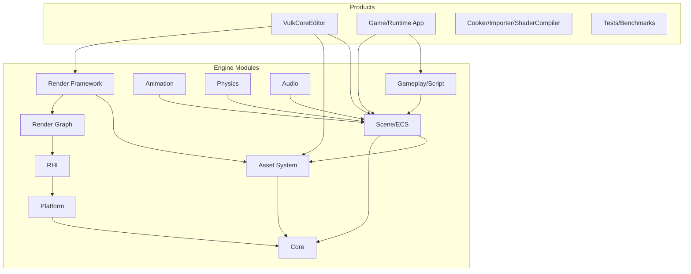
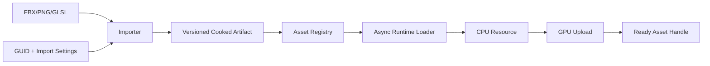

# VulkCore 高扩展性引擎架构设计方案

## 1. 目标与非目标

目标是在保留当前 Vulkan 渲染成果的基础上，形成一套可以被 Editor、Runtime、测试程序和工具共同复用的模块化引擎。它应允许新增一种组件、资产类型、渲染 Pass 或平台后端时，将改动限制在对应模块及注册代码中，而不是修改全局 `Renderer`。

设计重点：

- 明确所有权、生命周期和线程边界；
- 数据与执行解耦，编辑态与运行态解耦；
- 资产有稳定身份和可重建产物；
- GPU 工作由依赖图表达，RHI 屏蔽 Vulkan 细节；
- 功能通过注册和组合扩展；
- 每个层次可测试、可观测、可降级。

近期非目标：一次性实现所有大型商业引擎功能；为未知需求设计复杂分布式系统；同时维护多个图形后端。接口应保留后端边界，但先把 Vulkan 后端做正确。

## 2. 核心设计原则

### 2.1 依赖只能向下

高层通过稳定接口依赖低层，低层不感知具体游戏或 Editor。Editor 可以依赖 Runtime，Runtime 不依赖 Editor。Render 可以读取抽取后的 Render World，不能直接操作 ImGui 或 Scene Inspector。

### 2.2 数据身份与内存地址分离

序列化引用用 GUID/UUID，运行时访问用带 Generation 的 Handle。禁止把裸指针、数组下标、文件路径或 Vulkan Handle 作为长期身份。资源替换、热重载和异步完成只更新 Handle 对应槽位。

### 2.3 声明“需要什么”，调度器决定“何时执行”

Render Pass 声明读写资源，Job 声明依赖，Asset Loader 声明依赖资产。Barrier、并行度、加载顺序和生命周期由各自调度器推导，避免调用顺序成为隐式协议。

### 2.4 编辑数据、运行数据、GPU 数据分层

- Authoring World：可读、可序列化、保留名称和编辑元数据；
- Runtime World：面向逻辑更新，结构紧凑；
- Render World：每帧抽取出的只读渲染快照；
- GPU Scene：设备本地 Buffer 中的渲染数据。

分层会产生转换成本，但换来线程安全、PIE、回放和 GPU Driven 的清晰边界。

### 2.5 能力可查询、功能可降级

设备能力通过 `FeatureSet` 显式表达。Renderer Feature 声明最低需求和 Fallback，不让 Shader 或业务代码假设所有设备都有 Bindless、Mesh Shader 或 Ray Tracing。

## 3. 目标分层



建议的 CMake 目标：

```text
VulkCore::Core
VulkCore::Platform
VulkCore::Asset
VulkCore::Scene
VulkCore::RHI
VulkCore::RHI.Vulkan
VulkCore::RenderGraph
VulkCore::Render
VulkCore::Particles
VulkCore::Editor
VulkCore::Runtime
VulkCore::Tools.AssetCooker
VulkCore::Tools.ShaderCompiler
VulkCore::Tests
```

不是每个目录都必须成为动态库。初期可用静态库控制依赖；插件边界只放在确实需要第三方扩展和热装载的位置，避免 ABI 负担扩散。

## 4. Core 层

Core 不包含窗口、Vulkan、ImGui 或具体资产格式。它提供：

- 基础类型、Span、Hash、String ID；
- `Result<T, Error>` 与错误上下文链；
- GUID、Generation Handle、Type ID；
- 日志、Assert、Trace Event；
- Allocator 接口和内存标签；
- Job System、Task Event、Cancellation Token；
- 反射元数据的运行时最小表示；
- Module/Service Registry；
- 版本和序列化公共协议。

建议错误不跨层抛出无上下文字符串异常。资源加载、Pipeline 创建等可恢复路径返回结构化 Error；真正违反内部不变量时使用 Assert。日志应携带 Asset GUID、Entity UUID、Frame Index、VkResult 等字段，便于聚合分析。

## 5. Platform 层

Platform 负责 OS 差异：

- Window、Monitor、DPI、多窗口；
- Input Device 和 Raw Event；
- 文件映射、异步 IO、目录监听；
- 动态库、线程、计时、进程；
- 剪贴板、对话框等 Editor 服务；
- 图形 Surface 创建所需原生句柄。

GLFW 可以继续作为首个实现，但不应直接出现在 Scene/Render 公共接口中。`Application` 从硬编码循环演进为 Host：按顺序驱动 Platform Events、Fixed Simulation Tick、Variable Update、Render Extract、Render Submit。

```cpp
struct EngineLoop {
    void tick() {
        platform.pollEvents(eventQueue);
        input.consume(eventQueue);
        fixedStepper.run([&](float dt) { runtime.fixedUpdate(dt); });
        runtime.update(clock.frameDelta());
        renderWorld = extractor.extract(runtime.world());
        renderer.render(renderWorld, editorOverlay);
    }
};
```

## 6. RHI 与 Vulkan 后端

### 6.1 RHI 公共对象

RHI 暴露后端无关的强类型 Handle：

```cpp
struct BufferHandle  { uint32_t index; uint32_t generation; };
struct TextureHandle { uint32_t index; uint32_t generation; };
struct PipelineHandle { uint32_t index; uint32_t generation; };

struct BufferDesc {
    uint64_t size;
    BufferUsage usage;
    MemoryDomain memory;
    std::string debugName;
};

class RenderDevice {
public:
    Result<BufferHandle> createBuffer(const BufferDesc&);
    void destroyDeferred(BufferHandle, GpuCompletionValue lastUse);
    CommandList beginCommands(QueueType);
    GpuCompletionValue submit(SubmitBatch);
    const DeviceFeatures& features() const;
};
```

RHI 不应过度抽象到“所有 API 最小公分母”。它可以采用 Vulkan/D3D12 风格的显式资源和同步模型，未来其他后端映射到同一语义。Vulkan 特有扩展放入 Feature/Extension 接口，不污染 Scene 和 Material。

### 6.2 资源生命周期

每个 Frame Context 包含：

- Command Pool/Allocator；
- Descriptor Arena；
- 持久映射 Upload Ring；
- Query Pool；
- Deferred Deletion Queue；
- 完成 Timeline 值。

资源槽位记录最后使用值。销毁只是让逻辑 Handle 失效，真正 Vulkan 销毁发生在 GPU Timeline 超过最后使用值后。这样材质热重载、窗口 Resize 和资产卸载都不需要 `vkDeviceWaitIdle`。

### 6.3 内存与上传

采用 VMA 或同等能力的分配层：

- Device Local 大块子分配；
- Host Upload/Readback Pool；
- Dedicated Allocation 仅用于大资源或驱动要求；
- 显存 Budget 和 Eviction 统计；
- Buffer/Image Alias 由 Render Graph 控制。

Upload Manager 接收数据任务，批量录制到 Transfer Queue；返回 `UploadTicket`。渲染 Pass 若依赖未完成资产，可选择等待 Timeline 或使用 fallback，避免主线程同步阻塞。

### 6.4 Descriptor 策略

第一阶段使用按频率分 Set 的 Descriptor Cache；第二阶段在设备支持时提供 Bindless Texture/Buffer Table：

```text
set 0: Frame/View constants
set 1: Scene lights, shadows, environment
set 2: Bindless resource table or material resources
set 3: Draw/Object data
```

Bindless 是优化手段，不应成为资产身份。Material 保存 Asset Handle，Render Backend 在当前设备上解析为 Descriptor Index；不支持 Descriptor Indexing 时自动生成传统 Descriptor Set。

## 7. Render Graph

### 7.1 Pass 声明

```cpp
graph.addPass<WaterPassData>(
    "Water",
    QueueType::Graphics,
    [&](PassBuilder& b, WaterPassData& d) {
        d.sceneColor = b.read(sceneColor, ShaderRead{});
        d.sceneDepth = b.read(sceneDepth, DepthRead{});
        d.output = b.write(hdrColor, ColorAttachment{LoadOp::Load});
    },
    [&](const WaterPassData& d, RenderContext& ctx) {
        drawWater(ctx, d, renderQueue.water());
    });
```

Graph 编译阶段负责：

- 验证先写后读和未初始化读取；
- 拓扑排序和死 Pass 剔除；
- 计算 Image Layout、Stage、Access 和 Queue Ownership Barrier；
- 根据不重叠生命周期复用临时 Image/Buffer；
- 生成 GPU Debug Marker 和 Timestamp；
- 输出 Graphviz/JSON 供 Editor 检查。

### 7.2 Renderer Feature

Shadow、Water、Particles、Post Process、Selection 等实现 `IRenderFeature`：

```cpp
class IRenderFeature {
public:
    virtual FeatureRequirements requirements() const = 0;
    virtual void registerPasses(RenderGraph&, const RenderView&) = 0;
    virtual void onShaderReload(const ShaderReloadEvent&) {}
    virtual ~IRenderFeature() = default;
};
```

Feature 通过模块注册，不应直接修改主 Renderer。它声明自己需要的 Scene Component、Asset Type、Graph Resource 和 Device Feature。Feature 关闭后相关 Pass 和临时资源自动消失。

## 8. Render World 与 GPU Scene

Runtime World 可能在逻辑线程更新，不应让渲染线程遍历可变 ECS。Extract 阶段读取本帧可见的组件变化，写入双缓冲/三缓冲 Render World：

```text
Runtime Components
  Transform + MeshRenderer + Light + Camera + ParticleEmitter
            │ extract changed data
            ▼
Render World
  Views + Instances + Materials + Lights + Emitters
            │ upload/patch
            ▼
GPU Scene
  Instance Buffer + Material Buffer + Light Buffer + Indirect Commands
```

Render World 中只保留渲染所需 POD 数据和资源 Handle，不包含层级编辑信息。Render Queue 根据 View 构建 Draw Packet：

```cpp
struct DrawPacket {
    PipelineHandle pipeline;
    MeshGpuHandle mesh;
    MaterialGpuHandle material;
    uint32_t instanceIndex;
    uint64_t sortKey;
};
```

Opaque Key 优先减少 Pipeline/Material 切换并近到远；Alpha Key 按 Render Layer、Priority、远到近排序。水面可拥有独立 Queue。GPU Driven 阶段再把可见性和命令生成迁移到 Compute/Indirect，不改变 Scene API。

## 9. Scene 与 ECS

### 9.1 实体模型

推荐 Entity = `index + generation`，组件按类型存入稠密 Pool/Archetype。场景文件中的 UUID 映射到加载后的 Runtime Entity。Hierarchy 是普通组件关系，不嵌套存储实体对象：

```cpp
struct TransformComponent {
    vec3 localPosition;
    quat localRotation;
    vec3 localScale;
    mat4 worldMatrix;
    Entity parent;
    uint32_t dirtyVersion;
};

struct MeshRendererComponent {
    AssetHandle<MeshAsset> mesh;
    std::vector<AssetHandle<MaterialInstance>> materials;
    RenderLayer layer;
};

struct ParticleEmitterComponent {
    AssetHandle<ParticleEffect> effect;
    uint32_t randomSeed;
    bool playing;
};
```

这使粒子继续满足“必须绑定 GameObject/Entity”，同时允许同一实体组合 Light、AudioSource 或 Script。`ParticleEffect` 是可复用资产，Emitter Component 保存实例状态和 Override。

### 9.2 系统调度

System 声明读写组件集合和阶段：Fixed Update、Variable Update、Late Update、Render Extract。Scheduler 根据冲突建立任务依赖；例如 Animation 写 Local Transform，Transform Propagation 读 Local/写 World，Render Extract 读 World。

不建议一开始实现极端复杂的 Archetype ECS。先用稳定 Entity Registry + Sparse Set 组件池即可，保持 API 后续可替换。决定数据布局前应以真实场景 Profile，而不是理论吞吐为依据。

### 9.3 Prefab 与场景

Scene 保存 Entity UUID、Component Type ID、版本和属性。Prefab 是独立资产，场景实例保存 Prefab GUID、源 Entity Local ID 和 Override Patch。加载流程：

1. 读取并迁移 Schema；
2. 创建所有 Entity 和 UUID 映射；
3. 反序列化组件；
4. 解析跨实体/资产引用；
5. 执行 `OnLoaded` 验证；
6. 缺失引用进入可诊断状态。

未知组件数据应可保留，避免未安装插件时打开并保存场景造成数据丢失。

## 10. 资产系统

### 10.1 Source 与 Artifact



Source 文件只用于编辑器/构建机；Runtime 加载已标准化的 Artifact。Artifact Header 至少包含：Asset Type、Schema Version、Importer Version、Source Hash、Dependency GUID、Platform/Quality Variant 和 Payload Chunks。

### 10.2 依赖与热重载

Asset Registry 维护正向/反向依赖。例如 Texture 变化使 Material GPU Binding 失效，Shader Interface 变化使 Material Template 重新验证。热重载构建新资源，验证成功后原子交换 Handle Slot；旧 GPU 资源延迟销毁。失败时保留上一版可用资源并显示错误。

### 10.3 当前模型导入迁移

把现有 `ModelLoader` 分成：

- `AssimpModelImporter`：只在工具侧运行；
- `MeshArtifact`：标准顶点流、Index、Submesh、Bounds，可选 LOD/Meshlet；
- `MaterialImportResult`：生成或引用 Material Assets；
- `ScenePrefabArtifact`：保留源节点层次和稳定 Sub-object ID；
- Runtime `MeshLoader`：不依赖 Assimp，只读取 Artifact。

这样发布包无需携带完整 Assimp，加载路径更快、格式更可控。

## 11. Shader 与材质系统

### 11.1 Shader 工具链

Shader 编译器输入 Program 描述、源码、Include、Define 和目标平台，输出：

- SPIR-V；
- Reflection Manifest；
- 依赖列表；
- Layout/Interface Hash；
- 编译日志；
- 可选 Pipeline Cache Key。

编译发生在构建或后台工具进程，不阻塞渲染线程。编辑器热重载也通过同一工具链，避免“离线编译和运行时编译行为不同”。

### 11.2 Material Template 与 Instance

Material Template 定义 Shader Program、Render State、Parameter Schema 和 Render Queue；Material Instance 只存参数值和纹理 Handle，并可继承父材质。

```text
PBR_Opaque.template
  ├── Stone.material       baseColor/normal/roughness
  ├── Wood.material
  └── PaintedMetal.material

Water.template
  ├── River.material       flow map/wave parameters
  └── Lake.material
```

Inspector 由 Reflection 元数据生成控件，范围、颜色、纹理语义和 Tooltip 不再硬编码在 `Renderer`。参数上传进入 Material Buffer，Object 参数进入 Instance Buffer，避免每 Draw 大量 Descriptor Set。

## 12. 粒子系统的目标形态

保留现有 GameObject/Entity 绑定语义，扩展为三层：

- `ParticleEffect` Asset：模块图/模块栈、Renderer 配置、纹理/材质引用；
- `ParticleEmitterComponent`：Entity 上的播放状态、Seed、实例 Override；
- Particle Runtime：CPU 或 GPU Backend，管理 Simulation Buffer 和 Draw Command。

模块可包含 Spawn、Initialize、Update、Collision、Color/Size over Life、Noise、Sub-emitter、Events、Renderer。每个模块声明读写的 Particle Attributes，编译器生成紧凑布局和 CPU/GPU 执行程序。

演进顺序：

1. CPU Quad → Instance Buffer，先消除每粒子 6 顶点展开；
2. 固定步长、确定 Seed、全局透明 Queue；
3. Effect Asset 与 Emitter Instance 分离；
4. GPU Storage Buffer 模拟、Alive/Dead List、Indirect Draw；
5. Depth Collision、Soft Particle、Sub-emitter 和 Event Readback；
6. 大规模特效再考虑 Compute Queue 并行。

GPU Backend 应有 CPU Fallback，方便测试、低端平台和确定性场景。

## 13. Editor 架构

Editor 不直接写组件内存，而通过反射 Property API 和 Command Bus：

```cpp
editor.execute(SetPropertyCommand{
    .targets = selection,
    .property = propertyPath,
    .before = oldValues,
    .after = newValue
});
```

Command 可撤销、合并拖动操作、标记 Scene Dirty，并记录变更来源。核心服务包括：

- Selection Service；
- Document/Scene Service；
- Undo Stack；
- Asset Browser/Importer；
- Inspector/Property Drawer Registry；
- Viewport/Gizmo/Picking；
- Play-in-Editor World Clone；
- Console/Profiler/Render Graph Inspector。

Editor 面板通过注册扩展。一个 Particle 插件可以同时注册 Component、Importer、Inspector Drawer 和 Render Feature，而不修改核心 Editor switch-case。

## 14. 模块与插件

插件 Manifest 声明名称、语义版本、Engine API 版本、依赖、提供的类型和加载阶段。注册接口示例：

```cpp
class IEngineModule {
public:
    virtual void registerTypes(TypeRegistry&) = 0;
    virtual void registerSystems(SystemRegistry&) = 0;
    virtual void registerAssets(AssetRegistry&) = 0;
    virtual void registerRenderFeatures(RenderFeatureRegistry&) = 0;
    virtual void shutdown() = 0;
};
```

应区分两类扩展：

- 静态模块：随引擎编译，C++ ABI 风险小，用于核心高性能能力；
- 动态插件：经过版本化 C 接口或窄 ABI 边界，用于项目/第三方扩展。

序列化 Type ID 必须稳定，不能依赖 C++ RTTI 名称。卸载插件前验证是否仍有其组件、资产、任务或 GPU Feature 存活。

## 15. 线程与帧调度

推荐最初采用三类执行域，而不是过早设计无限线程：

```text
Main/Editor Thread
  Platform events, Editor commands, World orchestration

Worker Pool
  Animation, transforms, culling preparation, import/decode, general jobs

Render Thread
  Render extraction consume, graph compile/record, RHI submit

GPU Queues
  Graphics / optional Compute / optional Transfer
```

共享数据必须有所有权协议：Main 写 Runtime World；Extract 产生不可变 Render Snapshot；Render Thread 只读 Snapshot；GPU Resource 创建通过线程安全队列进入 Render Device。不得让后台 Asset Job 直接销毁正在使用的 Vulkan 对象。

固定逻辑 Tick 与渲染解耦：Simulation 使用累积器，Render 使用最近两个 Transform Snapshot 插值。编辑器暂停时仍可渲染和操作相机，单步只推进一个 Fixed Tick。

## 16. 序列化与版本迁移

每种 Asset/Component 有独立 Schema Version 和迁移链：

```cpp
registry.registerMigration<ParticleEmitter>(1, 2,
    [](ArchiveObject& o) {
        o["startSpeedRange"] = makeRange(o.take("startSpeed"));
    });
```

原则：

- GUID/UUID 使用文本或固定 16-byte 表达；
- 枚举保存稳定符号或显式数值协议，不能依赖声明顺序；
- 浮点、坐标系、角度单位在 Schema 中统一；
- Scene 保存使用原子替换；
- Runtime Artifact 可以是二进制，但必须由 Source 重建；
- 迁移器在 CI 中用历史 Fixture 做测试；
- 不认识的插件组件以 Opaque Blob 保留。

## 17. 可观测性和测试架构

### 17.1 可观测性

- CPU Zone：Update、Extract、Graph Compile、Command Record、Asset IO；
- GPU Zone：每个 Render Pass Timestamp；
- Counters：Draw、Dispatch、Triangle、Visible Instance、Particle、Upload Bytes；
- Memory：CPU Tag、GPU Heap、Transient Peak、Descriptor 使用；
- Graph Inspector：Pass、Resource、Barrier、Alias；
- Resource Inspector：状态、引用、最后使用帧、源 Asset。

### 17.2 测试层次

| 层次 | 示例 |
|---|---|
| Unit | Handle generation、Transform hierarchy、Particle deterministic update、Schema migration |
| Integration | Asset import→artifact→load、Shader reflection→pipeline layout、Scene round-trip |
| RHI | Buffer copy、texture upload、layout transition、swapchain recreate |
| Render | PBR spheres、normal map orientation、alpha order、water depth、particle texture |
| Stress | 高频热重载、连续 resize、资源创建销毁、显存压力 |
| Performance | 固定场景 CPU/GPU P95、上传和内存预算回归 |

Null RHI 可测试 Graph 和资源生命周期逻辑；Vulkan Headless/隐藏窗口跑真实 GPU 集成；Golden Image 使用容差和感知差异，不追求跨 GPU 逐位相同。

## 18. 从当前代码迁移的映射

| 当前对象/逻辑 | 迁移目标 | 过渡策略 |
|---|---|---|
| `Application` | Engine Host + Platform Window | 保留现有 loop，逐步插入 fixed/update/extract/render 阶段 |
| `VulkanContext` | `VulkanRenderDevice` | 先包裹现有创建函数，再替换返回类型化 Handle |
| `SwapChain` | `RHI::Swapchain` + Frame Attachments | 深度移出 Swapchain，跟随 Graph/Frame Context |
| `Buffer`/`Texture` | RHI Resource + Allocator | 保持旧构造适配层，内部切到分配器 |
| `MeshData` | Mesh Asset + Scene Prefab | Importer 输出 Artifact；旧 Loader 只用于转换工具 |
| `ModelNode` | Entity + Components | 先构建镜像 Entity，不立刻删除旧层次 |
| `MaterialData` | Material Template/Instance | 写转换器，固定现有参数语义 |
| `particleSystems_` Map | ParticleEmitter Component/Runtime Pool | 节点 ID 映射到 Entity，保持每对象独立实例 |
| `recordCommandBuffer` | Render Features + Render Graph | 按 Opaque/Water/Transparent/Particle/Overlay 顺序逐 Pass 迁移 |
| ImGui 控件 | Editor Panels + Property Drawers | 先搬文件，再改为 Command/Reflection API |
| `vulkcore.ini` | 版本化 Scene/Asset | 保留只读旧格式 Importer，成功迁移后写新格式 |

迁移过程中应保持一个可运行主干。每迁移一个 Pass 或资源类型，使用截图基线和 Validation 对比，再删除旧路径。避免“先建半年新框架，最后一次性切换”。

## 19. 推荐目录布局

```text
engine/
  core/
  platform/
  asset/
  scene/
  rhi/
    public/
    vulkan/
  render_graph/
  render/
    features/
      opaque/
      water/
      particles/
      debug/
  animation/
  physics/
  audio/
editor/
  app/
  panels/
  commands/
  property_drawers/
tools/
  asset_cooker/
  shader_compiler/
samples/
tests/
assets/
shaders/
```

目录只表达边界，真正约束来自 CMake target 的 `PUBLIC/PRIVATE` 依赖、模块 API 检查和 CI。禁止通过相对路径跨模块包含私有头文件。

## 20. 架构决策与落地顺序

建议为以下决策建立 ADR：

1. Entity ID/GUID 方案；
2. Source Scene 与 Runtime Artifact 格式；
3. RHI 是否以 Vulkan 语义为基线；
4. GPU Allocator 选型；
5. Descriptor/Bindless 分级策略；
6. Render Graph 同步模型；
7. Material Reflection 和参数布局；
8. 插件 ABI 与版本规则；
9. Job System 和 World/Render Thread 所有权；
10. 坐标系、单位、色彩空间和时间步长。

最小可行落地顺序：

```text
测试与诊断
  → 模块目标与 RenderDevice
  → Handle/Frame Context/延迟销毁
  → Asset GUID 与 Entity 身份
  → Render World/Queue
  → Render Graph
  → Shader Reflection/Material Instance
  → PBR/Light/Shadow/Post Process
  → Editor Command/Prefab/PIE
  → Animation/Physics/Audio/Script
```

## 21. 成功判据

架构改造完成与否不能按“类是否拆出来”判断，而应满足：

- 新增一个后处理效果只新增 Feature/Pass/Shader 和注册，不修改 RHI/Scene 核心；
- 新增一种组件可自动序列化并生成 Inspector，旧场景可迁移；
- 纹理热重载失败保留旧资源，成功后无 `vkDeviceWaitIdle` 原子切换；
- Editor 与独立 Runtime 链接同一引擎库，Runtime 不包含 ImGui；
- 同一 Mesh/Material 可被大量实体实例化，不复制资产数据；
- 水面可声明读取 Scene Color/Depth，由 Graph 自动生成同步；
- Particle Effect 是资产，Emitter 必须绑定 Entity，CPU/GPU Backend 可替换；
- Validation、资源统计、CPU/GPU 时间和 Graph 状态可以在工具中观测；
- 一个小型项目可完成导入、搭建、运行、调试、保存、Cook 和发布闭环。

达到这些标准后，VulkCore 才具备持续增加高级图形与通用引擎能力的高扩展性基础。
