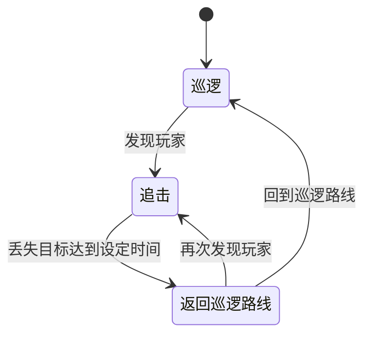

# 敌人行为编辑与巡逻

游戏项目通常用代码实现可复用的能力，再由关卡或玩法设计人员在编辑器里配置敌人何时使用这些能力。例如，程序员实现移动到目标点、感知玩家和播放动画，关卡设计人员为每只守卫设置巡逻路线、视野范围和停留时间。同类敌人可以共用预制体、行为配置和默认参数，各实例再按关卡需要覆盖巡逻点等属性。

## 常见编辑方式

| 方式 | 编辑内容 | 适用场景 |
| --- | --- | --- |
| Inspector 参数 | 速度、视野、巡逻点、等待时间、动画片段 | 同类敌人在不同关卡里的布置与调参 |
| 状态机 | 巡逻、追击、返回等状态及切换条件 | 行为阶段清晰，容易观察当前状态的敌人 |
| 行为树 | 用条件、顺序和优先级组织可复用任务 | 需要在搜索、支援、撤退等多种行为之间作决策的敌人 |
| 脚本或原生代码 | 感知规则、移动接口、决策逻辑和特殊动作 | 实现通用能力或编写个别敌人的专属机制 |

这些方式可以组合使用。状态机或行为树决定做什么，任务节点调用移动和感知接口，Inspector 暴露可调参数，场景或行为资源负责保存配置。

## 引擎如何支持敌人行为

- **感知与决策**由感知组件更新目标信息，例如最后一次看到玩家的位置。状态机或行为树读取这些信息，决定切换状态或执行任务。行为树可以用 Blackboard（黑板）保存任务之间共享的数据。
- **导航与移动**由决策层设置目的地，导航系统计算可通行路径，移动组件执行位移和转向。简单巡逻可以沿两点直线移动，复杂关卡可以接入 NavMesh 寻路和局部避障。
- **动画**可以根据实际移动速度和当前状态切换待机、走路和跑步。编辑器可以单独预览片段，也可以在运行时观察状态、当前目标和导航路径。
- **编辑器与资源**通过组件属性、脚本或图形节点开放配置，并将结果保存到场景、预制体或独立行为资源。Unreal 常用 Behavior Tree 与 Blackboard 或 StateTree 组织决策，由 Blueprint 或 C++ 实现任务。Unity 常用 C# 组件和 Inspector 配置行为，并接入 NavMesh 和 Animator。

## VulkCore 当前实现

`Enemy Patrol` 采用 Inspector 参数驱动的方式。`scenes/game.scene` 中的三只敌人已配置两点巡逻。目标点以出生点为基准设置世界 X/Z 偏移，单位为米。敌人沿直线往返，在有地形时沿地表高度移动，到点停留后折返。默认在行走时播放 `Walk`，停留时播放 `Wait`。[场景配置](../scenes/game.scene) · [巡逻与动画运行时](../src/Renderer/RendererSceneGraph.cpp)

1. 按 `F5` 进入编辑状态，在左侧场景树选中敌人。巡逻会暂停，敌人回到出生点，便于调整位置和路线。
2. 在右侧 **Inspector → Enemy Patrol** 设置启用状态、目标点 X/Z 偏移、行走速度、到点停留时间、朝向偏移、行走片段和等待片段。为其他导入模型添加路线时，可点击 **Add Patrol**。[Inspector 控件](../src/Renderer/RendererGameEditor.cpp)
3. 如果选中的模型有骨骼动画，在 **Skeletal Animation → Clip** 中选播片段。预览提供播放、暂停、循环、速度和时间轴控制。SBFRES 或 BFRES 模型会查找同目录、同扩展名的 `<模型名>_Animation` 伴随动画包。[SBFRES 导入](09-sbfres-import.md) · [模型加载](../src/Utils/ModelLoader.cpp)
4. 点击 **Save** 将巡逻设置和已编辑的骨骼播放设置写入 `.scene` 的 `node_patrol` 和 `node_skeletal` 记录。再次按 `F5` 退出编辑，敌人从出生点重新巡逻，走动和停留时分别使用巡逻配置指定的片段。[场景读写](../src/Renderer/RendererScene.cpp)

## 用状态机扩展敌人行为

如果需要让守卫发现玩家后追击、丢失目标后回到路线，可以将现有巡逻作为 `Patrol` 状态，加入 `Chase` 和 `Return`。视野范围、丢失目标的等待时间和返回点可沿用 Inspector 的参数编辑方式。

关卡加入需要绕行的障碍后，可以把 `MoveTo` 从直线移动升级为导航寻路，继续沿用上面的状态切换规则。
